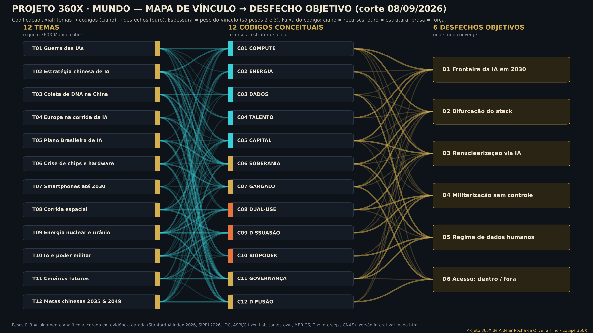

## Edição de desenvolvimento · 23/11/2026

O novo início conecta geopolítica, cenários condicionais e preservação humana. Inclui quatro ilustrações originais widescreen com versões WebP responsivas, explorador de três cenários em três horizontes, seis Frentes de Preservação propostas, aplicação local em Sobral e um checklist pessoal de 20 minutos.

- `index.html`: atlas ampliado, fontes e roteiro 30/90/365 dias.
- `realmetaverso.html`: cânone referenciado, mapa funcional, governança, pacto e três cenas literárias novas.
- `observatorio.html`: preservação da página inicial anterior, identificada pelo recorte de 17/11/2026.
- As novas frentes permanecem propostas: não alteram as Casas canônicas nem ratificam harmonizações dos compêndios.
- Marcações do checklist são locais e autodeclaradas; não comprovam execução institucional.
- JavaScript é opcional para a leitura; os controles dinâmicos e a exportação exigem JavaScript.

Verificação: `python3 scripts/check_static.py` e `node --check assets/js/futuro.js`. A revisão do conteúdo anterior foi amostral, não integral.

---

<p align="center">
  
</p>

<h1 align="center">🏰 Projeto 360X · Mundo</h1>

<p align="center"><b>Observatório geopolítico-tecnológico do Projeto 360X de Aldenir Rocha de Oliveira Filho</b><br>
12 temas · 12 códigos conceituais · 10 cadeias causais · 6 desfechos objetivos · projeção 2031 · 2036 · 2046</p>

<p align="center">
  🌐 <a href="https://aldenirfilho.github.io/projeto-360x-mundo/"><b>Abrir o site</b></a> ·
  🗺️ <a href="https://aldenirfilho.github.io/projeto-360x-mundo/mapa.html">Mapa de vínculo interativo</a> ·
  🧭 <a href="https://aldenirfilho.github.io/projeto-360x-mundo/temas.html">Os 12 temas</a>
</p>



---

## 🎯 A tese em uma linha

> Os 12 temas são **um sistema com três insumos** (🧮 compute, ⚡ energia, 🧬 dados), **dois atores** que controlam os três (🇺🇸 EUA e 🇨🇳 China), **um relógio** (a agenda chinesa 2027 → 2030 → 2035 → 2049) e **um interruptor** (📜 governança: regras que funcionam ou colapsam).

## 🧭 Os 12 temas

| Código | Tema | Em uma frase |
| --- | --- | --- |
| T01 | 🤖 Guerra das IAs | Oligopólio tripolar — OpenAI × Anthropic × Google — e a disputa migrou para energia, memória e chips |
| T02 | 🇨🇳 Estratégia chinesa de IA | Open-weight, eficiência e difusão (AI+); o calcanhar é a memória HBM |
| T03 | 🧬 Coleta de DNA na China | Genoma como recurso estratégico: coleta interna, importação externa, exportação proibida |
| T04 | 🇪🇺 Europa na corrida da IA | Bem regulada e subcapitalizada: a “Suíça” da inferência |
| T05 | 🇧🇷 Plano Brasileiro de IA | Soberania declarada, chips indefinidos: o único país nos dois stacks |
| T06 | 💾 Crise de chips e hardware | A HBM canibaliza a DRAM comum: memória é o novo petróleo |
| T07 | 📱 Smartphones até 2030 | O terminal da IA: 2 nm, agentes no aparelho, dobráveis e satélite |
| T08 | 🚀 Corrida espacial | EUA à frente em tudo, exceto no cronograma; a órbita vira infraestrutura militar |
| T09 | ☢️ Energia nuclear e urânio | 12.187 ogivas, nenhum tratado — e a IA financiando o novo ciclo do combustível |
| T10 | 🎯 IA e poder militar | Modelos já planejam ataques dos dois lados; a linha vermelha contratual perdeu na apelação |
| T11 | 🔮 Cenários futuros | Dois eixos, quatro mundos — sentinelas no lugar de profecias |
| T12 | 🏮 Metas chinesas 2035 & 2049 | A única agenda datada de ponta a ponta: o relógio do sistema |

## 🗺️ Páginas do site

| Página | O que traz |
| --- | --- |
| [`index.html`](index.html) | Tese, **sentinelas revistas em 17/11/2026**, 12 temas, 6 desfechos, mapa 2026 → 2046 e documentos |
| [`temas.html`](temas.html) | Dossiê de cada tema: evidências datadas, códigos dominantes, pegadinhas analíticas e atualização |
| [`mapa.html`](mapa.html) | Mapa interativo temas → códigos → desfechos, matrizes, 10 cadeias causais, linha do tempo, cenários e projeção |
| [`panorama.html`](panorama.html) | Base factual de 08/09/2026 com ≈45 fontes |
| [`analise.html`](analise.html) | Síntese completa e projeção 2031/2036/2046 |
| [`docs/`](docs/) | Os dois documentos em Markdown, para baixar e reutilizar com crédito |

## 📡 Atualização de 17/11/2026 (resumo)

- 🗳️ **Brasil:** Lula reeleito em 25/10 com 51,79 % dos votos válidos (TSE); o PL 2338 ainda aguarda parecer do relator.
- 🚀 **Starship:** chegou à órbita em 28/09; o reabastecimento em órbita ainda não foi demonstrado.
- ☢️ **Irã:** a AIEA segue sem acesso ao urânio altamente enriquecido (relatório de 13/11).
- 🎯 **Anthropic × Pentágono:** o Tribunal de Apelações do D.C. manteve a designação de “risco de cadeia” (set/26) — 🟠 correção da leitura de 08/09.
- 🤝 **EUA–China:** canal bilateral para incidentes de IA (26/09); a China recusa, por ora, negociar limites de arsenal (16/11).
- 💾 **Memória:** nova alta de contratos de DRAM no 4T26 (TrendForce).
- 📱 **Apple:** o dobrável saiu como **iPhone Duo**, a partir de US$ 1.999 — 🟠 correção do “iPhone Ultra”.

Detalhes e fontes na seção [📡 Sentinelas](https://aldenirfilho.github.io/projeto-360x-mundo/#sentinelas).

## 🔬 Método

Teoria fundamentada aplicada à geopolítica: **codificação aberta** (fatos datados) → **codificação axial** (12 códigos que atravessam temas) → **cadeias causais** com evidência → **codificação seletiva** (6 desfechos com indicador, data e sentinelas). Legenda usada em todo o material: ✅ verificado em fonte datada · 📄 panorama de 08/09 · 🧠 conhecimento prévio · ⚠️ incerto ou a conferir · 🟠 correção.

## 🛡️ Limites e uso responsável

- Pesos de 0 a 3 e classes do mapa (“periferia”, “hedging”) são **julgamento analítico**, não medição.
- As projeções 2031 / 2036 / 2046 são **extrapolações sob premissas explícitas**, não previsões.
- O material trata de Estados, empresas e instituições com fontes públicas; não acusa pessoas, não publica dados pessoais e não é serviço investigativo.
- Correções e fontes melhores: abra uma [issue](https://github.com/aldenirfilho/projeto-360x-mundo/issues).

## 🗂️ Estrutura

```
index.html · temas.html · mapa.html · panorama.html · analise.html · 404.html
assets/css/   base.css (fontes, cores, moldura) · site.css (páginas)
assets/img/   mapas e diagramas em WebP (site) e PNG 2400 px (download)
assets/fonts/ Cinzel · Alegreya Sans · JetBrains Mono · OpenDyslexic (+ licenças OFL)
docs/         panorama e análise em Markdown
```

Site 100 % estático, sem rastreamento, sem dependências externas e com **🔤 modo leitura OpenDyslexic** no topo de cada página. Publicado pelo GitHub Pages a partir da branch `main`.

## ✍️ Créditos

**Aldenir Rocha de Oliveira Filho** — idealizador, gerador, coordenador, diretor e promotor da **Equipe 360X**.
Projeto 360X de Aldenir Rocha de Oliveira Filho · pesquisa assistida por IA, com fontes datadas e verificáveis.
O Projeto 360X sucede a marca “NEXUS”; esta é a continuação do antigo observatório NEXUS Mundo.

## 📄 Licenças

- Texto, análises e imagens: © 2026 Aldenir Rocha de Oliveira Filho — todos os direitos reservados; citações com crédito são bem-vindas.
- Fontes tipográficas: SIL Open Font License 1.1 (arquivos em `assets/fonts/LICENSES/`).
- Contornos dos mapas: Natural Earth (domínio público).

<p align="center"><i>Grato desde já. 🙏</i></p>
