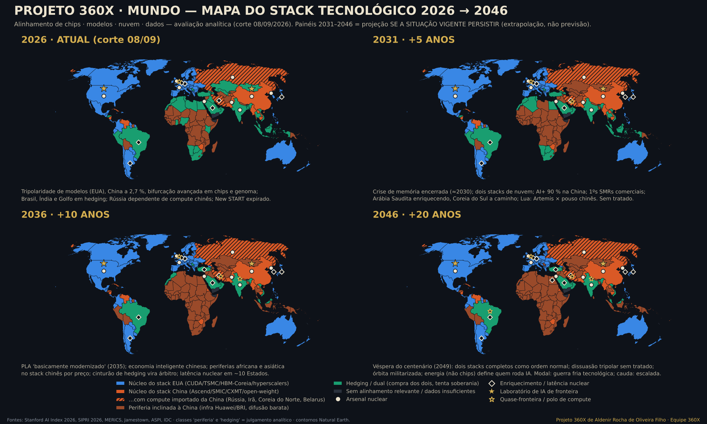

# 🗺️ 360X MUNDO — MAPA DE VÍNCULO → DESFECHO OBJETIVO
### 12 temas · 12 códigos conceituais · 10 cadeias causais · 6 desfechos · projeção 2031 / 2036 / 2046

> **Data de corte:** 08/09/2026 · **Preparado para:** Projeto 360X · Mundo — observatório geopolítico-tecnológico
> **Base:** *Panorama Geopolítico-Tecnológico — set/2026* (≈45 fontes, no projeto) + 20 fontes novas lidas em 08/09 para DNA, IA militar, metas chinesas e smartphones.
> **Legenda:** ✅ verificado hoje · 📄 panorama de 08/09 · 🧠 conhecimento prévio (pré-jun/2026) · ⚠️ incerto/em disputa
> **Imagens que acompanham este documento:** [mapa de vínculo](../assets/img/360x-mapa-vinculo.png) · [mapa geopolítico 2026→2046](../assets/img/360x-mapa-geopolitico-2026-2046.png) · [triângulo compute × energia × dados](../assets/img/360x-triangulo-compute-energia-dados.png). Versão interativa: [dossiê HTML](../mapa.html).
> **Nota editorial 360X:** pesos, classes de mapa e projeções são julgamento analítico ancorado em fontes datadas — não são previsões nem acusações. O que não pôde ser confirmado está marcado ⚠️.

---

## 0️⃣ RESUMO EXECUTIVO — em 8 linhas

| # | Achado | Bottom line |
|---|--------|-------------|
| 1 | 🎯 **Tese** | Os 12 temas são **um sistema com três insumos** (compute, energia, dados), **dois atores** que controlam os três (EUA, China), **um relógio** (2027→2030→2035→2049, chinês) e **um interruptor** (governança). |
| 2 | 🧩 **Códigos mais centrais** | C11 Governança (27), C06 Soberania (25), C07 Gargalo (24), C05 Capital (23) — o sistema é sobre **regras, dependências e dinheiro**, não sobre "melhor modelo". |
| 3 | 🏁 **Desfechos mais alimentados** | D2 Bifurcação do stack (24) e D4 Militarização sem controle (23) — ambos crescem quando a governança falha. |
| 4 | 🏮 **Tema-relógio** | T12 (metas chinesas) é o único que toca **todos os 12 códigos**; T02 (China) é o mais largo (26). |
| 5 | 🧬 **Destaque de 08/09** | Claude foi usado para **identificar alvos** na Op. Epic Fury (Irã) ✅ — e a Anthropic foi banida do Pentágono por recusar **armas autônomas + vigilância doméstica**, depois reintegrada por juiz (ago/26) ✅. A linha vermelha sobreviveu ao próprio uso. |
| 6 | 🔮 **Cenário modal sob persistência** | 🧊 **Q2 — guerra fria tecnológica estável** (dois stacks, dissuasão funciona, hedging como profissão). Cauda: 🔥 Q3 (20 anos sem tratado + IA em NC3). |
| 7 | 🌍 **Mapa 2046** | Infraestrutura instalada em 2026–36 decide alinhamento por décadas; cinturão de hedging (Brasil, Índia, Golfo, Turquia) vira árbitro; latência nuclear em ~10 Estados. |
| 8 | 🧭 **Para o cidadão** | Hardware: comprar com memória de sobra antes de 2027; LLMs em uso profissional só com verificação; regra do deepfake explicada em família antes de 04/out; temas quentes (IPO, urânio, chips) são os mais usados em golpes. |

---

## 1️⃣ TESE CENTRAL (categoria central da codificação seletiva)

> **Quem controlar o triângulo *compute × energia × dados* em 2030 define a ordem de 2035; a posição do interruptor de governança define se 2049 é expansão ou autodestruição.**

| Elemento | Estado em set/2026 | Evidência |
|----------|-------------------|-----------|
| 🧮 **Compute** | Nvidia >60 % do compute mundial; gargalo chinês = HBM (<300 mil Ascend/ano) | 📄 |
| ⚡ **Energia** | 9,8 GW nucleares contratados por big techs; HALEU US$ 900 mi | 📄 |
| 🧬 **Dados** | CNCB chinês >100 PB de genomas (fev/26); OpenAI 1,1 bi MAU | ✅ 📄 |
| 🏮 **Relógio** | 2027 PLA centenário + AI+ 70 % → 2030 AI+ 90 % + Lua + fusão → 2035 modernização básica → 2049 "país socialista moderno e forte" | ✅ 🧠 |
| 📜 **Interruptor** | New START morto (fev/26); AIEA sem acesso ao Irã; AI Act adiado; BIOSECURE sancionado (dez/25) | 📄 ✅ |

**Método (Teoria Fundamentada aplicada a geopolítica):** codificação aberta (≈60 fatos datados) → codificação axial (12 códigos transversais) → cadeias causais (M01–M10) → codificação seletiva (6 desfechos com indicador, data e sentinelas). Pesos 0–3 = **julgamento analítico ancorado em evidência**, não medida estatística.

---

## 2️⃣ OS 12 CÓDIGOS CONCEITUAIS

| Código | Família | Definição | Pesa mais em |
|--------|---------|-----------|--------------|
| **C01 🧮 COMPUTE** | ⚙️ Recursos | Chips, HBM, data centers — quem tem FLOPS | T01 · T02 · T06 · T12 |
| **C02 ⚡ ENERGIA** | ⚙️ Recursos | GW para IA; nuclear, HALEU, fusão, reator lunar | T09 · T01 · T08 · T12 |
| **C03 🧬 DADOS** | ⚙️ Recursos | Texto, telemetria, biometria, genoma | T03 · T01 · T02 · T07 · T10 |
| **C04 🧑‍🔬 TALENTO** | ⚙️ Recursos | Formação, diáspora, repatriação, P&D | T02 · T01 · T12 |
| **C05 💰 CAPITAL** | ⚙️ Recursos | Investimento privado/estatal, valuations, IPOs, subsídios | T01 · T08 · T02 · T04 · T05 · T09 |
| **C06 🛡️ SOBERANIA** | 🏛️ Estrutura | Autonomia tecnológica; "IA soberana"; nuvem e genoma nacionais | T02 · T03 · T04 · T05 · T12 |
| **C07 ⛓️ GARGALO** | 🏛️ Estrutura | Dependência assimétrica: EUV, HBM, TSMC, SWU, refueling orbital | T06 · T02 · T09 · T08 |
| **C08 ⚔️ DUAL-USE** | ⚔️ Força | Civil ↔ militar: enriquecimento, SLV↔míssil, LLM↔ciber, genoma↔bio | T08 · T09 · T10 |
| **C09 🎯 DISSUASÃO** | ⚔️ Força | Capacidade de infligir custo; velocidade de decisão; NC3 | T08 · T09 · T10 · T11 |
| **C10 👁️ BIOPODER** | ⚔️ Força | Controle de populações por dados: DNA, deepfake, vigilância | T03 · T05 · T07 · T10 |
| **C11 📜 GOVERNANÇA** | 🏛️ Estrutura | Regras e sua erosão: AI Act, TSE, New START, AIEA, export controls, BIOSECURE | T03 · T04 · T05 · T09 · T10 · T11 |
| **C12 🌐 DIFUSÃO** | 🏛️ Estrutura | Quem acessa: preço, open-weight, AI+, o smartphone como terminal | T02 · T06 · T07 · T12 |

---

## 3️⃣ MATRIZ TEMAS × CÓDIGOS (0–3)

| Tema | C01 | C02 | C03 | C04 | C05 | C06 | C07 | C08 | C09 | C10 | C11 | C12 | **Σ** |
|------|----|----|----|----|----|----|----|----|----|----|----|----|-----|
| **T01** 🤖 Guerra das IAs (EUA) | 3 | 2 | 2 | 2 | 3 | 1 | 2 | 2 | 1 | 1 | 2 | 2 | **23** |
| **T02** 🇨🇳 Estratégia chinesa | 3 | 1 | 2 | 3 | 2 | 3 | 3 | 2 | 1 | 1 | 2 | 3 | **26** |
| **T03** 🧬 DNA na China | 0 | 0 | 3 | 1 | 1 | 3 | 1 | 2 | 0 | 3 | 3 | 1 | **18** |
| **T04** 🇪🇺 Europa | 2 | 1 | 1 | 1 | 2 | 3 | 2 | 1 | 1 | 1 | 3 | 1 | **19** |
| **T05** 🇧🇷 Brasil | 2 | 1 | 1 | 1 | 2 | 3 | 2 | 1 | 0 | 2 | 3 | 2 | **20** |
| **T06** 💾 Chips e hardware | 3 | 1 | 0 | 0 | 2 | 2 | 3 | 0 | 0 | 0 | 2 | 3 | **16** |
| **T07** 📱 Smartphones 2030 | 2 | 1 | 2 | 0 | 1 | 1 | 2 | 0 | 0 | 2 | 1 | 3 | **15** |
| **T08** 🚀 Espaço | 1 | 2 | 1 | 0 | 3 | 2 | 2 | 3 | 3 | 0 | 1 | 1 | **19** |
| **T09** ☢️ Nuclear e urânio | 0 | 3 | 0 | 0 | 2 | 2 | 3 | 3 | 3 | 0 | 3 | 0 | **19** |
| **T10** 🎯 IA militar | 2 | 0 | 2 | 1 | 2 | 1 | 1 | 3 | 3 | 2 | 3 | 1 | **21** |
| **T11** 🔮 Cenários | 2 | 2 | 1 | 1 | 1 | 1 | 1 | 2 | 3 | 2 | 3 | 2 | **21** |
| **T12** 🏮 Metas 2035/2049 | 2 | 2 | 1 | 2 | 2 | 3 | 2 | 1 | 2 | 1 | 1 | 3 | **22** |
| **Σ (centralidade)** | 22 | 16 | 16 | 12 | 23 | **25** | **24** | 20 | 17 | 15 | **27** | 22 | |

**Matriz códigos × desfechos (Σ por desfecho):** D1 Fronteira **19** · D2 Bifurcação **24** · D3 Renuclearização **19** · D4 Militarização **23** · D5 Dados humanos **16** · D6 Acesso **18**.

---

## 4️⃣ AS 10 CADEIAS CAUSAIS (mecanismos)

| # | Cadeia | Mecanismo (1 frase) | Evidência-âncora | Desfecho |
|---|--------|--------------------|------------------|----------|
| **M01** 💾 Lei do HBM | C01→C07→C12 | A fronteira exige HBM; HBM canibaliza DRAM; o hardware de todos encarece | DRAM +172 %; OpenAI ≈40 % da DRAM 📄; smartphones **−12,9 %** em 2026 (IDC) ✅ | D6 |
| **M02** 🇨🇳 Gargalo > talento | C04+C01→C07→C12 | China tem talento e modelos; falta HBM; responde com eficiência + open-weight | 53,5 % da DeepSeek formada na China; gap 2,7 %; <300 mil Ascend/ano 📄 | D1 · D2 |
| **M03** ⚡ IA come energia | C01→C02→C08→C09 | Data centers contratam reatores → HALEU → enriquecimento "normal" → latência se espalha | 9,8 GW; HALEU US$ 900 mi; Saudi 5–20 % sem Protocolo Adicional 📄 | D3 · D4 |
| **M04** 🎯 Compressão de decisão | C03→C08→C09 × C11↓ | LLMs encurtam sensor-tiro dos dois lados; tratados morrem | Claude na Epic Fury ✅; PLAAF 100+ unidades ✅; New START expirado 📄 | D4 |
| **M05** 🧬 Soberania por dados | C03→C06→C10 × C11 | China coleta dentro, importa fora, não exporta; Ocidente responde com listas | Tibete 25–33 % ✅; CNCB >100 PB ✅; BIOSECURE dez/25 ✅ | D5 · D2 |
| **M06** 💰 Capital como arma | C05→C01→C06 | Ordem de grandeza define quem inventa e quem hospeda | EUA US$ 344 bi (23:1) 📄; China ≈€60 bi chips ✅; UE €20 bi; BR R$ 2,6 bi 📄 | D1 · D2 |
| **M07** 🚀 Órbita como infra | C05→C07→C08→C09 | Lançador + constelação + data center num só ator; órbita militarizada | SpaceX+xAI IPO; Golden Dome US$ 185 bi; refueling pendente 📄 | D4 · D3 |
| **M08** 🏮 Relógio chinês | C06→C12→C09 | A única agenda datada ponta a ponta; os outros reagem a ela | 2027/2030/2035/2049 ✅; 15º Plano retirou meta de 70 % em chips ✅ | todos |
| **M09** 📱 Terminal e periferia | C12→C07→C10 | Quem controla o aparelho controla a difusão; RAM cara empurra o Sul para o barato chinês | iPhone Ultra US$ 2.000–2.500 📄; dobráveis +30 % ✅; 7.500 mAh chineses 📄 | D6 · D5 |
| **M10** 🌍 Intermediários escolhem | C06 × C07 × C11 | Soberania sem EUV/HBM/SWU é escolha de fornecedor | Brasil: UFRN (GPU?) + RJ Huawei/iFlytek 📄; Mistral+Samsung+ASML 📄 | D2 · D6 |

---

## 5️⃣ OS 6 DESFECHOS OBJETIVOS

| Desfecho | Indicador | Estado set/26 | Data-chave | Sentinelas |
|----------|-----------|---------------|------------|------------|
| **D1 🏁 Fronteira da IA em 2030** | Gap Elo (2,7 %); share de compute (Nvidia >60 %); modelos notáveis (EUA 50 / UE 2) | ◆ tripolar americano, China convergindo | 2027 (Stargate, Grok 5, SSI) · **2030** (meta chinesa 2017) | CXMT HBM3E ⚠️ · lab chinês top-3 · IPO Anthropic |
| **D2 🧱 Bifurcação do stack** | Nvidia na China 95 %→8 %; lista BCC (dez/26); países com "escolha dupla" | ▲ avançada em chips e genoma; parcial em modelos | jul/27 RJ · fim/27 UFRN · dez/27 AI Act · ago/28 | GPU da UFRN · adesões à WAICO · open-weight chinês em nuvem americana |
| **D3 ⚡ Renuclearização via IA** | 9,8 GW/13 acordos; HALEU; novos enriquecedores (Saudi, Coreia do Sul, Brasil) | ● dinheiro indo para reatores, não ogivas | 2027 TMI-1/SPARC · 2028 Helion ⚠️ · **2030** Kairos/reator lunar/BEST · 2032–35 TerraPower | 1º SMR comercial · acordo 123 saudita · Rokkasho/Coreia |
| **D4 🎯 Militarização sem controle** | Tratados EUA–Rússia: **0**; contratos IA–DoD (4×200 mi; 7 classificados); HEU 440,9 kg | ■ único freio visível é contratual (linha vermelha Anthropic) | **2027** PLA · **2028** Golden Dome · NC3: sem data | Acordo NC3 EUA–China · AIEA em Isfahan · Directive 3000.09 · decisão final Anthropic × DoD |
| **D5 👁️ Regime de dados humanos** | CNCB >100 PB; Tibete 25–33 %; Y-STR 35–70 mi; HGR/Biossegurança/DSL/PIPL; BIOSECURE; 1260H (188); AI Act; TSE 23.610 | ▲ assimetria: China importa e não exporta | **04/out/26** eleição · dez/26 BCC · dez/27 AI Act | Minuta HGR mai/26 · BINSA no Senado · PL 2338 ⚠️ |
| **D6 🌍 Acesso: dentro/fora** | DRAM +172 %; memória 35 % do PC; smartphones −12,9 %/ASP +14,2 %; AI+ 70/90 %; Sabiá R$ 206 vs R$ 590 | ■ 2026–27 é o vale; não há "esperar cair" | 2027 Micron · 2028 Samsung · **2030** SK Hynix | DDR5 spot · CXMT HBM · fim dos 128 GB |

---

## 6️⃣ LINHA DO TEMPO DOS DESFECHOS (2026 → 2049)

| Ano | Marcos (D = desfecho movido) |
|-----|------------------------------|
| **2026** (set–dez) | D6 09/09 iPhone Ultra + 18 Pro 📄 · D4 15/09 Starship voo 14 📄 · D5 04/10 eleição BR sob tese de deepfake 📄 · D4 MOU Irã "enriquecimento zero" ⚠️ · D5 dez: lista BCC ✅ · D1 SSI/IPO Anthropic ⚠️ |
| **2027** — centenário do PLA | D4 01/08 PLA "intelligentizado" ✅ · D6 AI+ 70 % ✅ · D3 TMI-1 religado, SPARC 1º plasma 📄 · D2 RJ Huawei (jul) + UFRN (fim) 📄 · D5 02/12 AI Act alto risco 📄 · D4 Artemis III em LEO 📄 · D6 Micron alívio 📄 |
| **2028** — Lua americana · Golden Dome | D4 pouso Artemis ⚠️ · D4 Golden Dome ⚠️ · D5 02/08 AI Act produtos 📄 · D3 Helion 50 MW ⚠️, SR-1 Marte (dez) 📄 · D6 Samsung fim do aperto 📄 · D6 GenAI em 70 % dos smartphones 🧠 |
| **2030** — fim do 15º Plano | D1 China "líder mundial em IA" 🧠 · D6 AI+ 90 %, digital 12,5 % do PIB, 25 % não fóssil ✅ · D4 pouso lunar chinês 📄 · D3 reator lunar EUA, Kairos 500 MW, Mistral 1 GW 📄 · D3 "lâmpada de fusão" BEST ⚠️ · D6 SK Hynix fim da crise, 6G 🧠 |
| **2035** — modernização básica | D1 economia inteligente plena ✅ · D4 defesa "basicamente modernizada" ✅ · D2 PIB per capita de país moderadamente desenvolvido 🧠 · D3 TerraPower 4 GW, ITER 2034 📄 |
| **2049** — centenário da RPC | D1 "país socialista moderno e forte" 🧠 · D4 exército "de classe mundial" ✅ · D3 ITER pleno (2039) → fusão comercial? ⚠️ · D5 expansão pactuada ou fragmentação 🔮 |

---

## 7️⃣ CENÁRIOS — DOIS EIXOS, QUATRO MUNDOS (Tema 11)

**Eixo horizontal** = D2 (interdependência mantida ↔ bifurcação profunda). **Eixo vertical** = C11 (regras funcionam ↔ regras colapsam). Sem probabilidades — com **sentinelas**.

| Quadrante | Nome | O que é | Puxa para cá |
|-----------|------|---------|--------------|
| Q1 regras + interdependência | 🌅 **Expansão pactuada** | Tratado NC3, AIEA de volta, RAM normal em 2028, fusão + reator lunar, IA científica comprime décadas de biologia | Acordo EUA–China NC3 · Mistral+Microsoft+modelos chineses no mesmo rack · SPARC ganho líquido |
| Q2 regras + bifurcação | 🧊 **Guerra fria tecnológica estável** | Dois stacks, dissuasão funciona, custo alto, Brasil/Europa escolhem lado | BIOSECURE + 1260H aplicados · UFRN GPU americana + RJ Ascend · WAICO com adesões |
| Q3 colapso + bifurcação | 🔥 **Escalada acelerada** | IA em NC3 sem tratado, Taiwan 2027–30, ciber a infra nuclear, HEU sem rastreio | New START sem sucessor por 2 anos · PLAAF strike-planning em exercício real · "IA que raramente diz não" no Pentágono ✅ |
| Q4 colapso + interdependência | 🌀 **Multipolaridade caótica** | Proliferação latente (Saudi, Coreia, Japão), open-weight militarizado por não estatais, deepfakes sem freio | Acordo 123 sem Protocolo Adicional replicado · Kimi/DeepSeek em ciberataques automatizados · PL 2338 morto |

**Painel de sentinelas (12 meses):** acordo NC3 EUA–China (■ só declaração 2024 🧠) · AIEA em Isfahan (■ sem acesso desde 28/fev 📄) · CXMT HBM3E (▲) · Starship refueling (▲ voo 14) · GPU da UFRN (▲ "a definir") · decisão final Anthropic × DoD (◆ liminar ago/26 ✅) · minuta HGR mai/26 (▲) · TSE aplica tese no 1º turno (● fixada 01/09) · TMI-1 no prazo (● contratado).

**Lentes (especulativas, 🧠):** *AI 2027* (Kokotajlo et al., 2025) = stress test do Q3 · *Superintelligence Strategy*/MAIM (Hendrycks, Schmidt, Wang, 2025) = New START para data centers, encaixa em Q2 · *Machines of Loving Grace* (Amodei, 2024) = Q1 otimista, o mais relevante para a saúde · FMI (2024) ≈40 % dos empregos expostos = o que decide se Q1 é politicamente estável.

---

## 8️⃣ MAPA GEOPOLÍTICO ATUAL E PROJETADO — 2026 → 2031 → 2036 → 2046

**Legenda do mapa:** azul = núcleo do stack EUA · laranja = núcleo do stack China (hachurado = compute importado da China: Rússia, Irã, Coreia do Norte, Belarus) · laranja-claro = periferia inclinada à China (infra Huawei/BRI, difusão barata) · verde = hedging/dual · cinza = sem alinhamento relevante · ● arsenal · ◇ enriquecimento/latência · ★ laboratório de fronteira · ☆ quase-fronteira/polo de compute. **Classes de periferia e hedging são julgamento analítico.**

**Confiança:** ● 2031 média (marcos contratados) · ▲ 2036 baixa · ■ 2046 narrativa.

### 8.1 Premissas de "persistência" (o que está sendo extrapolado)
1. Export controls americanos mantidos; Pequim mantém o veto a chips americanos → bifurcação em chips continua ✅📄.
2. Nenhum tratado novo: New START sem sucessor; nada vinculante sobre IA em comando nuclear 📄🧠.
3. China executa planos na taxa histórica do "Made in China 2025" (bem-sucedida em VE/renováveis, "mista" em chips — USSC ✅) → ~2/3 das metas, chips sempre atrasados.
4. Capital privado americano em IA ≥10× o chinês 📄; após 2030 o gargalo americano vira **energia**.
5. Crise de memória termina em 2028–30 📄; nenhuma nova crise equivalente.
6. **Sem guerra EUA–China** (Taiwan) — se houver, o mapa é o do Q3.
7. Europa regulada e subcapitalizada; Brasil na "escolha dupla" sem marco legal; Golfo e Coreia do Sul obtêm enriquecimento 📄.
8. Rússia = maior enriquecedora (29 mi SWU) e cliente de compute chinês 📄; Irã sem verificação da AIEA 📄.

### 8.2 Estado de cada desfecho por horizonte

| Desfecho | 2026 · atual ✅ | 2031 · +5 ● | 2036 · +10 ▲ | 2046 · +20 ■ |
|----------|----------------|-------------|--------------|--------------|
| **D1 🏁 Fronteira** | Tripolar EUA; China a 2,7 %; UE nicho | EUA mantêm fronteira fechada; China empata em open-weight; 5–6 labs de fronteira; 1ª descoberta médica atribuída a IA científica ⚠️ | Paridade funcional; vantagem por energia e dados; "liderança" setorial | Fronteira por domínio: EUA (ciência, defesa, finanças) × China (manufatura, robótica, difusão) |
| **D2 🧱 Bifurcação** | Chips e genoma bifurcados; Brasil nos dois stacks | Dois stacks de nuvem; CXMT 1 geração atrás; lista BCC aplicada; África/Ásia Central na periferia chinesa; UFRN + RJ operando | Litografia chinesa avançada (EUV ⚠️); Indonésia/Tailândia/Egito no stack chinês; cinturão de hedging vira árbitro | Bifurcação = ordem normal; hedging institucionalizado; Brasil quase-fronteira regional *se* unir energia + dados + stack |
| **D3 ⚡ Renuclearização** | 9,8 GW; HALEU; Saudi 5–20 % | TMI-1, Kairos, 1ºs SMRs; HALEU doméstico EUA; SPARC ganho líquido ⚠️; Saudi enriquecendo; Coreia do Sul ⚠️ | SMRs em escala (4 GW); reator lunar; fusão piloto ⚠️; ~10 Estados latentes; HALEU com dois fornecedores | Nuclear ≈25–30 % da eletricidade de data centers ⚠️; fusão comercial inicial ⚠️; "bomba virtual" como norma |
| **D4 🎯 Militarização** | 0 tratados; IA em alvos (Epic Fury; PLAAF); Golden Dome 2028; HEU sem contabilidade | IA de ataque rotinizada; Golden Dome parcial; China ~1.000 ogivas 🧠; HEU iraniano sem contabilidade há 5 anos | PLA "basicamente modernizado" (2035); paridade em ICBMs 🧠; IA em NC3 dos dois lados; órbita militarizada | China "exército de classe mundial" (2049); dissuasão tripolar sem tratado por 20 anos; enxames autônomos padrão |
| **D5 👁️ Dados humanos** | CNCB fechado; BIOSECURE; AI Act adiado; TSE deepfake | Depósito obrigatório no CNCB; BINSA; AI Act pleno; Brasil TSE + ANPD, marco ⚠️; modelos biológicos em bases fechadas | Regimes regionais consolidados; genoma de populações inteiras; medicina de precisão bifurcada; deepfake por rótulo + responsabilidade de plataforma | Dados humanos como território; "cidadania de dados"; genoma de ~1/3 da humanidade em bases estatais/corporativas ⚠️ |
| **D6 🌍 Acesso** | DRAM +172 %; smartphones −12,9 %; AI+ 70 % | RAM normal; GenAI >80 % dos smartphones 🧠; AI+ 90 %; 6G; brecha migra de hardware para **energia** | Divisão por eletricidade; Brasil (hidro + nuclear) com vantagem *se* tiver stack; smartphone cede a agentes/wearables ⚠️ | Acesso definido por energia + alinhamento; Sul Global bifurcado pela infraestrutura de 2026–36 |

### 8.3 O que muda no mapa, painel a painel
- **2031 — a bifurcação vira infraestrutura:** África subsaariana e Ásia Central passam para a periferia chinesa (telecom + compute barato 🧠); Arábia Saudita ◇ (enriquecendo); Coreia do Sul ◇ (⚠️); Emirados ☆ (polo de compute com chips americanos 🧠); Brasil permanece verde — o único país operando os dois stacks.
- **2036 — dois mundos funcionando:** Indonésia, Tailândia, Egito, Argélia, África do Sul e Peru migram para a periferia chinesa por preço e infraestrutura instalada; cinturão de hedging encolhe para Brasil, Índia, Golfo, Turquia, Malásia, Singapura — e cobra por escolher; Turquia ◇ ⚠️; Índia ☆; Europa azul com "soberania de inferência" sem fronteira própria.
- **2046 — véspera do centenário:** mapa quase congelado; Brasil ☆ *condicional* (energia + dados em PT-BR + um stack escolhido); Egito ◇ ⚠️; Irã ◇ indeterminado sem AIEA; **dissuasão tripolar sem tratado** = o desfecho mais perigoso e o mais provável sob persistência.

**Desfecho modal:** 🧊 Q2. **Cauda:** 🔥 Q3 — a persistência *acumula* risco mesmo sem ninguém decidir escalar. **Pontos de ruptura (6):** Taiwan · CXMT entregar HBM · tratado NC3 · colapso energético de data centers · descontinuidade tipo "AI 2027" · escolha de stack do Brasil/Índia.

> 🩺 **Leitura clínica:** trate a projeção como *prognóstico sem intervenção* — o curso natural da doença. Cada sentinela é um exame de controle; cada ponto de ruptura, uma intervenção que muda o prognóstico. Serve para decidir **onde intervir**, não para acreditar nela.

---

## 9️⃣ DOSSIÊS POR TEMA (codificação aberta) — compactos

| Tema | Códigos dominantes (3) | Evidências-âncora | Empurra para | Pegadinha analítica |
|------|------------------------|-------------------|--------------|---------------------|
| **T01 🤖 Guerra das IAs** | C01 C05 C02/C03/C04/C07/C08/C11/C12 (2) | Anthropic US$ 965 bi > OpenAI US$ 852 bi 📄; ChatGPT <50 % de share 📄; DoD 4×US$ 200 mi, OpenAI com engenheiros em unidades ✅; Claude na Epic Fury ✅ | D1 · D6 · D4 | Não é hegemonia: oligopólio tripolar em modelo, duopólio em compute (Nvidia + memória coreana); xAI vende US$ 1,25 bi/mês à Anthropic 📄 |
| **T02 🇨🇳 China** | C01 C04 C06 C07 C12 | Gap 2,7 %; 53,5 % da DeepSeek formada na China; Ascend <300 mil/ano; AI+ 70/90 % ✅; ≈€60 bi para chips ✅ | D1 · D2 · D6 | A escassez *melhorou* a engenharia chinesa (MoE, quantização): sanção que força inovação erode a si mesma |
| **T03 🧬 DNA na China** | C03 C06 C10 C11 | "Physicals for All" (Tibete 3 mi, Xinjiang 23 mi) ✅; Tibete 2016–22: 919 mil–1,2 mi amostras, 25–33 %, com crianças ✅; Y-STR 35–70 mi homens, 22/31 regiões, kits Thermo Fisher ✅; HGR 2019/Biossegurança 2021/DSL-PIPL 2021/Segredos 2024/minuta mai/26 ✅; BGI 52 países, 8,4 mi mulheres; CNCB >100 PB ✅; BIOSECURE 18/dez/25, 1260H 188 empresas, BINSA ✅ | D5 · D2 · D4 (⚠️) | Genoma de população + IA = modelo de fundação biológico: gargalo assimétrico dos chips, invertido a favor da China |
| **T04 🇪🇺 Europa** | C06 C11 | Mistral €3 bi a €21 bi 📄; 2 vs 50 modelos notáveis 📄; Gigafactories €20 bi (2027) 📄; AI Act adiado 📄; ASML = único gargalo que a Europa possui 🧠 | D2 · D5 | Tem o gargalo mais valioso do planeta (EUV) e não o usa como alavanca de IA — compare com a Coreia do Sul (HBM ↔ enriquecimento) |
| **T05 🇧🇷 Brasil** | C06 C11 | UFRN 7.200 PFLOPS (GPU ⚠️) + RJ Huawei/iFlytek 📄; Sabiá 4: 77,7 % jurídico, R$ 206 vs R$ 590 📄; Redata caducou; PL 2338 ⚠️; TSE tese 01/09 📄; INB 115 mil SWU 📄 | D2 · D5 · D6 | "Compramos o supercomputador antes de escrever a lei" 📄 — soberania sem regra é fornecimento |
| **T06 💾 Chips** | C01 C07 C12 | DRAM +172 %; memória 35 % do PC; smartphones −12,9 % ✅; fim 2027/28/30 📄; SMIC >1 mi dies mas <300 mil Ascend 📄 | D6 · D2 · D1 | A crise é de *memória*, não de chips: a alavanca está em Seul, não em Taipei |
| **T07 📱 Smartphones** | C12 | iPhone Ultra US$ 2.000–2.500, A20 Pro 2 nm, 12 GB 📄; dobráveis +30 % em 2026, CAGR 17 % até 2029 ✅; mercado −12,9 %/ASP +14,2 % ✅; S26 agente on-device 📄; GenAI 70 % até 2028 🧠; 6G ≈2030 🧠 | D6 · D5 · D2 | Em 2030 o aparelho é o nó final de três infraestruturas geopolíticas: chip, modelo e órbita |
| **T08 🚀 Espaço** | C05 C08 C09 | SpaceX+xAI IPO; Starship 13 voos sem refueling 📄; Artemis III→2027/28 📄; Golden Dome US$ 185 bi 📄; China LM-10/Mengzhou, pouso 2030 📄; NSTM-3 reator lunar 2030 📄 | D4 · D3 · D2 | O ator mais capaz é o pior em prazo; o segundo, o melhor: pouso "simultâneo" importa mais para D4 que para a ciência |
| **T09 ☢️ Nuclear** | C02 C07 C08 C09 C11 | 12.187 ogivas; New START morto 📄; guerra fev–abr/26, 440,9 kg HEU sem paradeiro 📄; SWU: Rússia 29 mi/Urenco 17/China 13,8 📄; acordo 123 saudita 📄; 9,8 GW; fusão 2027/2030/2034 📄 | D3 · D4 · D2 | Irã perdeu a *via* (centrífugas) e o mundo perdeu a *contabilidade* (HEU): governança colapsada com capacidade degradada |
| **T10 🎯 IA militar** | C08 C09 C11 | Anthropic "risco de cadeia" (mar/26) → 7 acordos classificados sem ela (mai/26) → juiz reverte (ago/26) ✅; Claude na Epic Fury ✅; PLAAF strike-planning 100+ unidades (03/ago/26) ✅; CNAS: agentes para alvos, BDA, ciber, enxames ✅; só declaração NC3 2024 🧠 | D4 · D5 · D1 | Único lugar do mundo onde "armas autônomas" e "vigilância doméstica" viraram cláusula contratual testada em tribunal |
| **T11 🔮 Cenários** | C09 C11 | Função de saída dos outros 11; lentes AI 2027/MAIM/Amodei/FMI 🧠 | todos | Sem probabilidades — só sentinelas |
| **T12 🏮 Metas 2035/2049** | C06 C12 | 15º Plano (12/03/26): PIB 4,5–5 %; P&D +7,1 %/ano; patentes 15,3→22; digital 12,5 %; não fóssil 25 %; meta de 70 % em chips **retirada** ✅; AI+ 70/90 %/2035 ✅; PLA 2027/2035/2049 ✅; dois centenários 2021/2049 🧠 | todos | Retirar a meta de chips não é recuo: trocou números de autossuficiência por números de difusão — a China admitindo M02 |

---

## 🔟 O QUE ISSO MUDA PARA O BRASIL E PARA O CIDADÃO

| Frente | Leitura prática | Vínculo |
|--------|-----------------|---------|
| 💾 Hardware | A crise de memória vai até 2028–30: quem precisa de computador ou celular tende a fazer melhor negócio comprando agora, com RAM de sobra; 128 GB está desaparecendo | D6 · M01 |
| 🧠 Uso profissional de IA | Modelos em português (Sabiá 4) já competem em tarefas jurídicas a 1/3 do custo; em qualquer área crítica (saúde, direito, engenharia) a saída de um LLM exige verificação humana e bancada própria de testes | D1 · T05 |
| 🗳️ Eleição de 04/out | Regra do TSE para explicar em família: conteúdo sintético tem rótulo; simular pessoa (viva, morta ou fictícia) em propaganda é proibido; rótulo não legaliza uso proibido | D5 |
| 🛡️ Golpes | "IPO da SpaceX", "cotas de urânio/HALEU", "chips de IA", "pré-IPO de laboratório" são os temas mais quentes de 2026 — e por isso os mais usados em fraudes; investimento só por instituição regulada pela CVM; retorno fixo prometido é sinal de golpe | D1 · D3 · T08 |
| ⚡ Política pública | O Brasil tem energia (hidro + nuclear), modelo em PT-BR e dois supercomputadores em stacks opostos — mas não tem marco legal nem regime tributário; soberania sem regra vira fornecimento | D2 · D6 · M10 |
| 🔬 Ciência e saúde | A IA científica (biologia, química medicinal) é onde o cenário otimista chega primeiro; universidades e hospitais-escola são a porta de entrada | Q1 · Lente 3 |

---

## 🤓 CURIOSIDADES DO CRUZAMENTO
1. O mesmo modelo (Claude) que ajudou a selecionar alvos no Irã ✅ foi banido do Pentágono por recusar *armas autônomas* — e reintegrado por um juiz. A linha vermelha sobreviveu ao próprio uso.
2. A China retirou a meta de 70 % de chips do 15º Plano ✅ no mesmo semestre em que Pequim proibiu comprar chips americanos 📄 — abandonou o número e manteve a bifurcação.
3. A Thermo Fisher (americana) vendeu kits Y-STR ajustados a etnias chinesas uma semana antes do programa nacional de DNA ✅ — e agora BGI/MGI (chinesas) estão banidas de contratos federais americanos.
4. Um smartphone de 2026 encareceu por causa do ChatGPT (HBM) 📄; um reator de 1979 (TMI-1) vai religar por causa do Copilot 📄. A IA reprecifica átomos.
5. A Arábia Saudita conseguiu enriquecer sem Protocolo Adicional 📄 no ano em que o Irã perdeu as centrífugas — a "latência" migrou de Teerã para Riad.
6. O Brasil vai rodar um supercomputador na Entity List americana e outro com GPU "a definir" 📄 — o único país que aparece nos dois stacks ao mesmo tempo.

## 🖼️ IMAGENS (entregues e possíveis)
**Entregues:** mapa de vínculo (Sankey estático) · mapa geopolítico 2026→2046 (4 painéis) · triângulo compute × energia × dados (6 atores).
**Próximas imagens previstas:** relógio 2027–2049 em anel (marcos chineses no aro interno, reações ocidentais no externo) · quadrantes de cenário com sentinelas como vetores · mapa-múndi da bifurcação de dados genômicos (hachura por regime) · diagrama do ciclo do combustível com data centers, HALEU e acordo 123 · versão widescreen de cada painel do mapa para slides.

## 📚 APROFUNDAMENTO
- 🧬 **Genoma × IA**: modelos de fundação biológicos e por que 100 PB fechados importam (farmacogenômica e medicina de precisão).
- 🎯 **Semiologia da linha vermelha**: o processo Anthropic × DoD cláusula por cláusula e a Directive 3000.09.
- 🏮 **15º Plano em números**: tabela oficial vs. entrega do 14º.
- ☢️ **HALEU explicado**: física, cadeia de suprimento e onde o Brasil (INB) entra.
- 📱 **Guia de compra 2026–27** sob a crise de RAM, com o evento de 09/09 incorporado.
- 🗳️ **Manual antideepfake** para a família (critérios do TSE + 5 testes caseiros).
- 🧊 **Auditoria cruzada multi-IA**: a mesma matriz 12×12 rodada em outros modelos para medir a divergência de pesos.
- 🌍 **Mapa por país** (Brasil, Índia, Golfo): o que cada um precisa fazer para sair do hedging sem ser capturado.

---

## 🔗 FONTES NOVAS (lidas em 08/09/2026)
**IA e poder militar:** [The Intercept — contratos IA × Pentágono](https://theintercept.com/2026/09/08/military-ai-weapons-contracts-openai-anthropic-google/) · [The Intercept — "IA que raramente diz não"](https://theintercept.com/2026/09/08/pentagon-openai-military-contract/) · [Army Times — Pentágono exclui a Anthropic (01/05/26)](https://www.armytimes.com/news/pentagon-congress/2026/05/01/pentagon-freezes-out-anthropic-as-it-signs-deals-with-ai-rivals/) · [CRS — disputa Pentágono–Anthropic](https://www.congress.gov/crs-product/IN12669) · [Air & Space Forces — agentes chineses; Claude na Epic Fury (CNAS)](https://www.airandspaceforces.com/chinese-ai-agents-air-and-space-operations-strike-planning/) · [Global Times via GlobalSecurity — PLAAF strike-planning (03/08/26)](https://www.globalsecurity.org/wmd/library/news/china/2026/08/china-260803-globaltimes01.htm) · [The Diplomat — PLA usa IA para planejar ataques](https://thediplomat.com/2026/08/chinas-military-is-now-using-ai-to-plan-strike-operations/) · [Jamestown — meta 2027 do PLA](https://jamestown.org/chinas-2027-goal-marks-the-plas-centennial-not-an-expedited-military-modernization/) · [RAND — PLA e IA](https://www.rand.org/pubs/perspectives/PEA4574-1.html)

**DNA e dados genômicos:** [ASPI — Genomic surveillance](https://www.aspi.org.au/report/genomic-surveillance/) · [Citizen Lab — DNA em massa no Tibete](https://citizenlab.ca/research/mass-dna-collection-in-the-tibet-autonomous-region/) · [Jamestown — securitização assimétrica do genoma (25/06/26)](https://jamestown.org/beijings-asymmetric-securitization-of-genomic-data/) · [Ropes & Gray — BIOSECURE Act sancionado](https://www.ropesgray.com/en/insights/alerts/2026/01/biosecure-act-enacted) · [The Economy — restrições a biotech chinesa; 1260H; BINSA](https://economy.ac/news/2026/06/202606289325) · [HRW — DNA em Xinjiang (2017)](https://www.hrw.org/news/2017/12/13/china-minority-region-collects-dna-millions)

**Metas chinesas:** [15º Plano Quinquenal — metas](https://en.wikipedia.org/wiki/15th_Five-Year_Plan) · [MERICS — a aposta do 15º Plano em IA](https://merics.org/en/comment/chinas-next-five-year-bet-ai-self-reliance-diffusion-and-lot-hype) · [USSC — "Intelligent everything" (AI+)](https://www.ussc.edu.au/intelligent-everything-china-s-policy-to-supercharge-ai-adoption) · [Conselho de Estado — diretriz AI+ (27/08/25)](https://english.www.gov.cn/policies/latestreleases/202508/27/content_WS68ae7976c6d0868f4e8f51a0.html) · [DigiChina — tecnologia no 15º Plano](https://digichina.stanford.edu/work/forum-technology-in-chinas-15th-five-year-plan/)

**Smartphones:** [IDC — dobráveis +30 % em 2026](https://my.idc.com/getdoc.jsp?containerId=prUS54017625) · [IDC — Worldwide Smartphone Forecast 2026–2030](https://my.idc.com/getdoc.jsp?containerId=US53433726) · [IDC — GenAI em 70 % dos smartphones até 2028](https://my.idc.com/getdoc.jsp?containerId=prUS52478124)

**Base (📄):** *Panorama Geopolítico-Tecnológico — set/2026* (projeto 360X MUNDO), com Stanford AI Index 2026, SIPRI Yearbook 2026, House of Commons Library, ISIS, ACA, SMR Intel, NASA/Space.com, IDC/Wikipedia (crise de memória), MCTI, TSE, Canaltech e demais — lista completa naquele documento.
